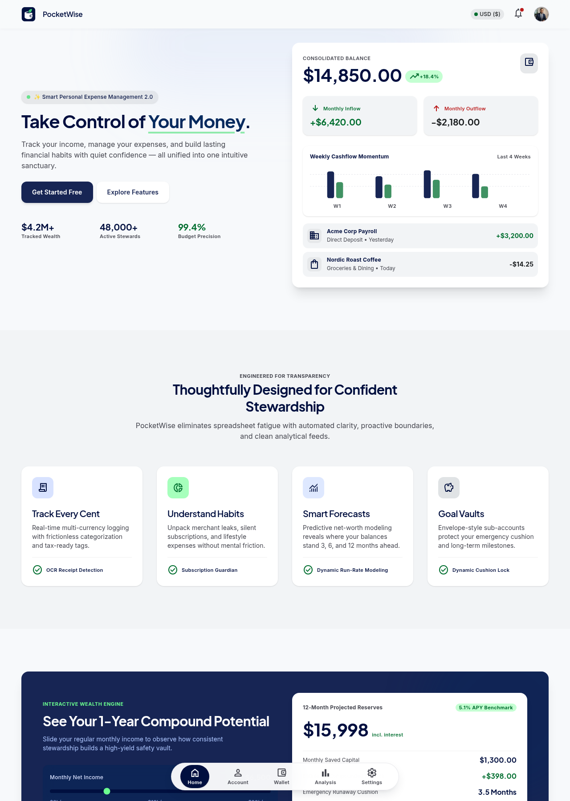
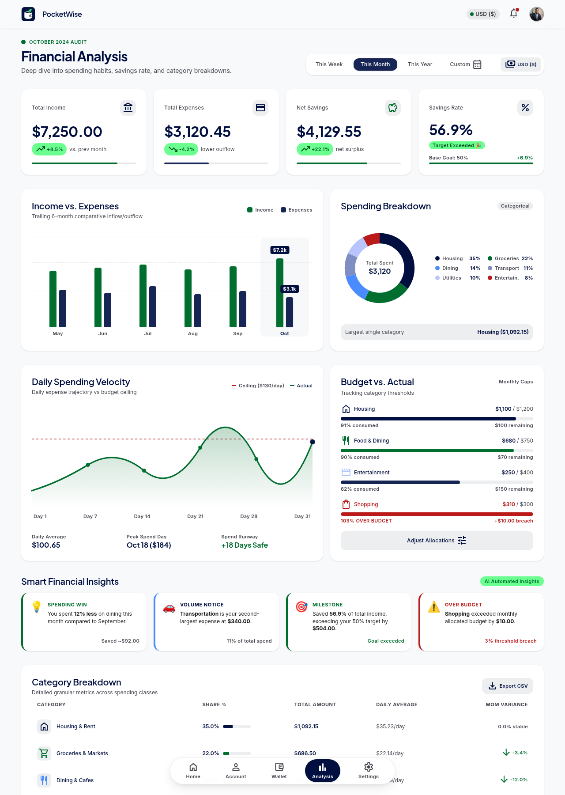
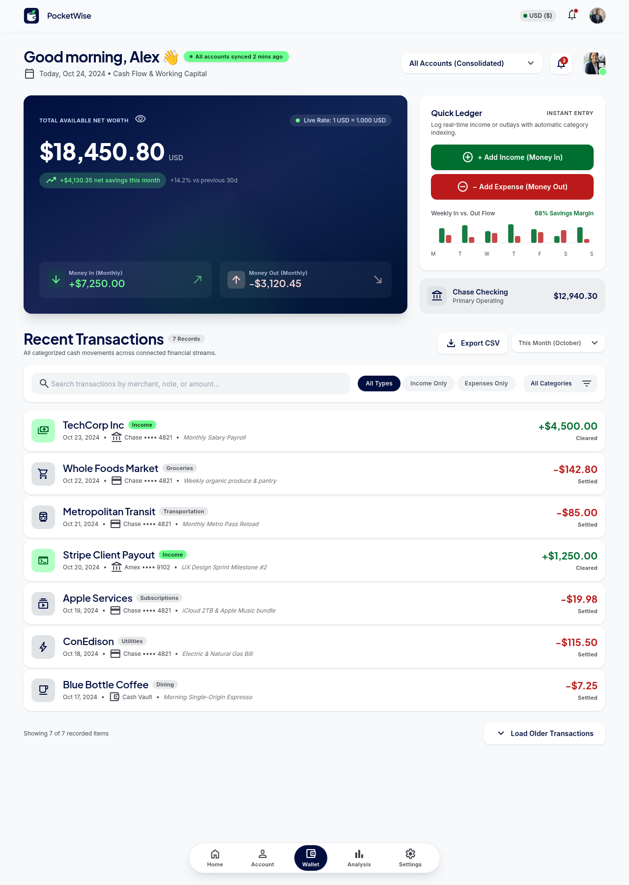
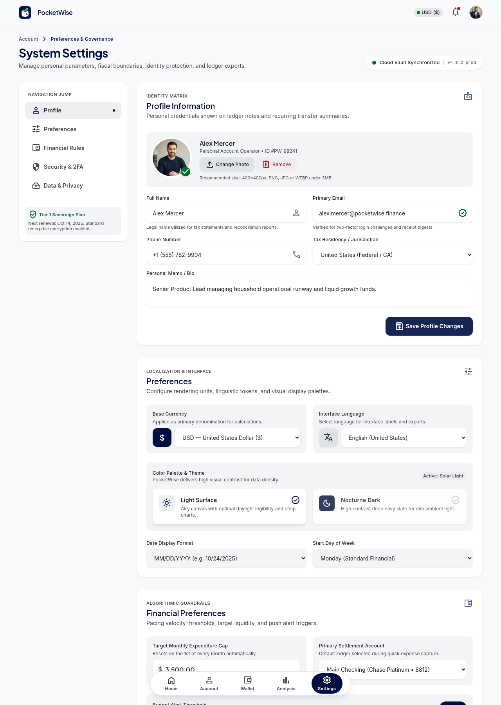
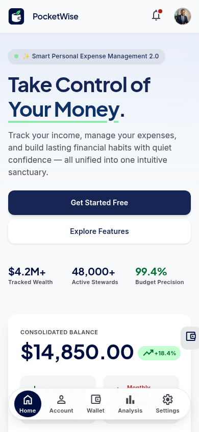
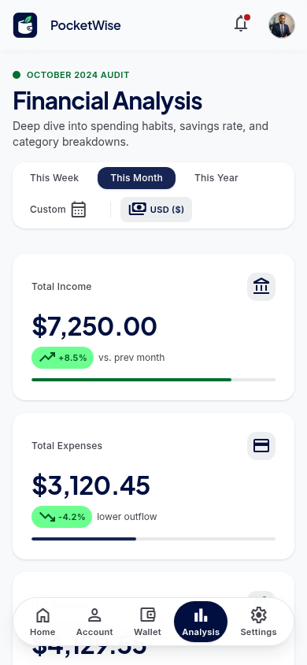
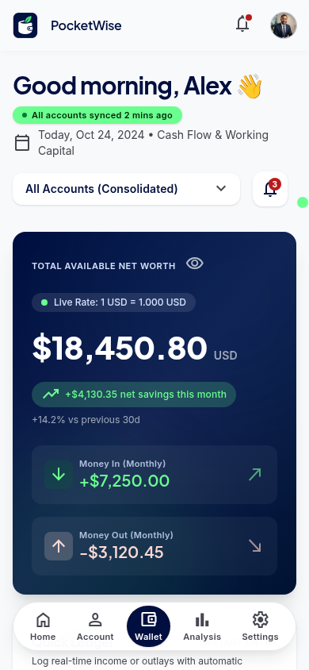
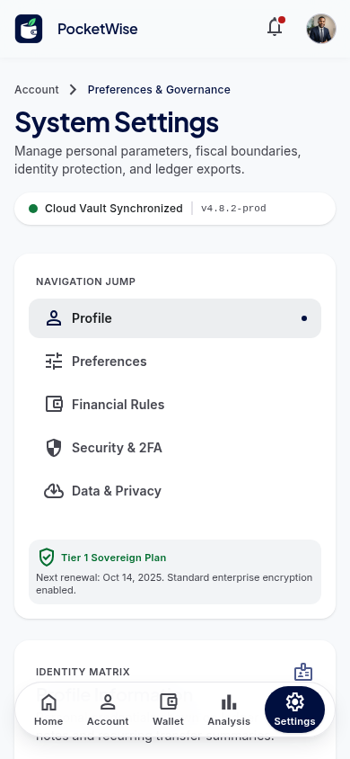

# 🪙 PocketWise — Take Control of Your Money

> **Calm, institutional-grade clarity for your personal finances, wealth tracking, and multi-currency budgeting.**

[](https://react.dev/)
[](https://tanstack.com/start)
[](https://vitejs.dev/)
[](https://tailwindcss.com/)
[](https://supabase.com/)
[](https://www.typescriptlang.org/)

---

## 📖 Overview

**PocketWise** is a full-stack personal finance and wealth management dashboard designed for effortless tracking of income, expenses, and investment portfolios. Built with React 19, TanStack Start, and Tailwind CSS v4, it combines institutional financial rigor with an elegant, responsive user experience.

---

## ✨ Key Features

- **📊 Consolidated Net Worth & Balance Tracking**: View real-time liquid wealth, monthly cashflow momentum, and net assets across accounts.
- **📈 Advanced Analytics & Visual Rhythm**: Interactive category breakdowns, cash flow graphs, and predictive budget pacing powered by SVG and chart primitives.
- **💳 Unified Multi-Currency Wallet**: Track checking, savings, fiat currencies (USD, EUR, GBP), and digital assets in one centralized vault.
- **🔐 Secure Authentication**: Integrated user authentication powered by Supabase with email/password and social login support.
- **⚙️ Customizable Settings**: Fine-grained controls for currencies, notification preferences, dark/light theme, and security settings.
- **📱 Responsive by Design**: Fully responsive layout tailored for desktop, tablet, and mobile screens.

---

## 🖼️ Application Preview

### Desktop Views

| Home / Dashboard | Financial Analysis |
| :---: | :---: |
|  |  |

| Multi-Asset Wallet | Profile & Settings |
| :---: | :---: |
|  |  |

### Mobile Views

<p align="center">
  
  
  
  
</p>

---

## 🛠️ Tech Stack

- **Framework**: [React 19](https://react.dev) + [TanStack Start](https://tanstack.com/start)
- **Routing**: [TanStack Router](https://tanstack.com/router) (file-based routing)
- **Bundler**: [Vite 8](https://vitejs.dev/) + Nitro server engine
- **Styling**: [Tailwind CSS v4](https://tailwindcss.com/)
- **UI Primitives**: [Radix UI](https://www.radix-ui.com/) & Lucide React Icons
- **Data & Backend**: [Supabase](https://supabase.com/) & [Drizzle ORM](https://orm.drizzle.team/)
- **Language**: TypeScript

---

## 📂 Project Structure

```text
Pocketwise00/
├── public/                 # Static assets & branding logos
├── src/
│   ├── components/         # Reusable UI widgets & Stitch screen bridge
│   │   └── ui/             # Radix UI primitives (dialogs, buttons, inputs)
│   ├── lib/
│   │   └── api/            # Backend service layer (auth, txs, accounts, categories, analytics)
│   ├── routes/             # TanStack Router route definitions
│   │   ├── __root.tsx      # Root layout & meta tags
│   │   ├── index.tsx       # / (Home / Landing view)
│   │   ├── analysis.tsx    # /analysis (Spending analytics & metrics)
│   │   ├── wallet.tsx      # /wallet (Accounts & transaction history)
│   │   ├── auth.tsx        # /auth (Login & onboarding)
│   │   └── settings.tsx    # /settings (Profile & preferences)
│   ├── screens/            # Screen templates & client-side interaction scripts
│   ├── integrations/       # Supabase client & TypeScript database types
│   └── styles.css          # Design system variables & Tailwind CSS setup
├── drizzle/                # Drizzle ORM schemas & migrations
├── supabase/
│   └── migrations/         # PostgreSQL schema migration & RLS policies
├── .env.example            # Environment variable template
└── package.json            # Project dependencies & scripts
```

---

## 🗄️ Database Architecture & Backend Setup

PocketWise uses PostgreSQL with Supabase Auth, Drizzle ORM, and Row Level Security (RLS) for complete multi-tenant privacy.

### Database Tables
* **`profiles`**: User profiles linked 1:1 with `auth.users`, storing names, currency (`EGP` default), contact details, and preferences.
* **`categories`**: Income and expense categories (both system-wide defaults and custom user categories).
* **`accounts`**: Multi-account management (cash wallets, bank accounts, digital cards).
* **`transactions`**: Central financial ledger with amount validation, automatic column synchronization (`transaction_type` $\leftrightarrow$ `type`), and JSONB AI metadata.

### Deploying the Database Schema (Supabase)
1. Go to your [Supabase Dashboard](https://supabase.com/dashboard) and open your project.
2. Navigate to the **SQL Editor** (`>_` in the left sidebar).
3. Open `supabase/migrations/20261112000000_pocketwise_backend_schema.sql` from this repository.
4. Copy its contents, paste into the SQL editor, and click **Run**.
5. All 4 tables, triggers, Row Level Security policies, indexes, and default categories will be created instantly.

---

## 🚦 Getting Started

### Prerequisites

Ensure you have the following installed on your machine:
- **Node.js** (v18.0.0 or later) or **Bun**
- **npm**, **pnpm**, or **bun**
- **Git**

### Installation

1. **Clone the repository**:
   ```bash
   git clone https://github.com/abdelrhmanmahmood84-gif/Pocketwise00.git
   cd Pocketwise00
   ```

2. **Install dependencies**:
   ```bash
   npm install
   # or
   bun install
   ```

3. **Configure Environment Variables**:
   Copy the example environment file and fill in your Supabase credentials:
   ```bash
   cp .env.example .env
   ```

   Edit `.env`:
   ```env
   SUPABASE_PROJECT_ID="your_supabase_project_id"
   SUPABASE_PUBLISHABLE_KEY="your_supabase_publishable_key"
   SUPABASE_URL="https://your_supabase_project.supabase.co"
   VITE_SUPABASE_PROJECT_ID="your_supabase_project_id"
   VITE_SUPABASE_PUBLISHABLE_KEY="your_supabase_publishable_key"
   VITE_SUPABASE_URL="https://your_supabase_project.supabase.co"
   ```

4. **Start the development server**:
   ```bash
   npm run dev
   # or
   bun run dev
   ```

   Open [http://localhost:3000](http://localhost:3000) (or the port specified in terminal) in your browser.

---

## 📜 Available Scripts

| Command | Description |
| :--- | :--- |
| `npm run dev` | Starts the local Vite development server with hot reloading |
| `npm run build` | Builds the application for production deployment |
| `npm run preview` | Previews the production build locally |
| `npm run lint` | Runs ESLint to check for code quality and syntax issues |
| `npm run format` | Formats all code using Prettier |
| `npm run test` | Runs the test suite via Vitest |

---

## 🧭 Page Routes

| Route | Description |
| :--- | :--- |
| `/` | Landing page featuring financial metrics, cashflow preview, and feature highlights |
| `/analysis` | Spending breakdown, category analytics, and monthly pacing charts |
| `/wallet` | Multi-asset portfolios, bank accounts, and transaction logs |
| `/auth` | Sign-in and registration portal with OAuth support |
| `/settings` | Profile details, display currency toggles, and security settings |

---

## 📄 License

This project is licensed under the [MIT License](LICENSE).
